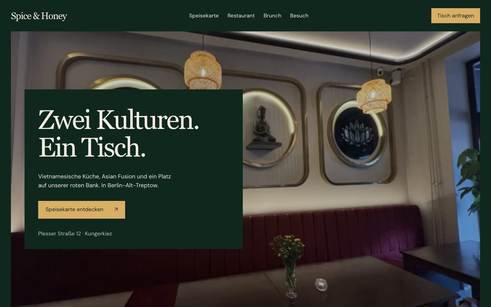

# Spice & Honey Website

Responsive Restaurantwebsite für **Spice & Honey**, Plesser Straße 12, Berlin-Alt-Treptow. Gestaltet aus dem bereitgestellten Concept Board: Waldgrün, Honiggold, warme Räume und die rote Samtbank.



## Enthalten

- Eigenständige Desktop- und Mobilansichten, inklusive mobiler Navigation.
- Drei Signature-Gerichte mit bestätigten Vor-Ort-Preisen aus dem Board.
- Vollständiges Wolt-Speisensortiment mit 36 Einträgen, Varianten und nachvollziehbaren „ab“-Preisen.
- Interaktive Bestellbeispiele: Feierabend, zu zweit, Wochenendbrunch.
- Tischanfragen per E-Mail, ausdrücklich mit persönlicher Bestätigung.
- Öffnungszeiten vor Ort, E-Mail, Routenlink und Google-Eintrag.
- Sichtbarer Tastaturfokus, native Details-Bereiche, Screenreader-Beschriftungen und reduzierte Bewegung.
- Lokale WebP-Bilder und Schriftdatei. Keine Tracker, Cookies oder externen Laufzeitbibliotheken.

## Lokal starten

Node.js 22 oder neuer. Keine Installation von npm-Paketen erforderlich.

```sh
npm run dev
```

Anschließend `http://127.0.0.1:4173` öffnen. Alternativ lässt sich `index.html` direkt im Browser öffnen.

```sh
npm run check
npm run build
npm run preview
```

Der Build erstellt `dist/` als vollständig statisches Hostingpaket. Der lokale Vorschau-Server ist nur für Entwicklung vorgesehen.

## Inhalte pflegen

| Datei | Zweck |
| --- | --- |
| `index.html` | Texte, Öffnungszeiten, Speisekarte, Links und Bildbeschreibungen |
| `app.js` | Mobile Navigation und die drei Besuchsbeispiele |
| `styles.css` | Markenfarben, responsive Layouts, Typografie und Bewegung |
| `impressum.html` | Betreiberangaben, derzeit als Vorbereitung gekennzeichnet |
| `datenschutz.html` | Entwurf passend zu den implementierten Funktionen |
| `assets/` | Lokal ausgelieferte Bilder, Schrift und Lizenz |
| `docs/menu-snapshot.json` | Referenzsnapshot der Wolt-Speisen, kein automatischer Live-Feed |
| `docs/design-review.md` | Art Direction, Skill-Anwendung und visuelle Bewertung |
| `docs/qa.md` | Prüfung und bekannte Grenzen |
| `docs/sources.md` | Quellen, Bildherkunft und Nutzungsstand |
| `docs/hosting.md` | Technische Übergabe für einen späteren Websitebetrieb |

Vor-Ort-Preise und Wolt-Preise getrennt pflegen. Die Wolt-Karte wird nicht automatisch aktualisiert. Änderungen an der Karte in `index.html` vornehmen; den Referenzsnapshot bei Bedarf entsprechend aktualisieren. Die Kurzbeschreibungen sind keine vollständige Allergenliste.

## Vor dem öffentlichen Websitebetrieb

Betreibername/Rechtsform/Vertretung und gegebenenfalls Register- und Umsatzsteuerangaben nachreichen. Telefonnummer auf Wunsch ergänzen. Datenschutzhinweise mit den tatsächlichen Betreiber-, Mailanbieter- und Hostingdaten vervollständigen. Nutzungsrechte der gelieferten und über Wolt bereitgestellten Bilder dokumentieren. Originalfotos in höherer Auflösung verbessern besonders die großen Restaurantmotive.

Die Website ist im öffentlichen GitHub-Repository gespeichert. Ein eigenständiger öffentlicher Hostingdienst und eine Domain sind noch nicht eingerichtet.

## Gestaltung

Angewendet: Apple Design, design-taste-frontend und [UI UX Pro Max](https://github.com/nextlevelbuilder/ui-ux-pro-max-skill). Richtung „The dark room“, Seed 1394981396. Die zwei inhaltlich begründeten Blueprintwechsel sind im Designbericht dokumentiert.

Der Code ist für das Restaurant erstellt. Restaurantmedien unterliegen den Rechten ihrer jeweiligen Inhaber. DM Sans steht unter SIL Open Font License 1.1; die Lizenz liegt in `assets/FONT-LICENSE.txt`.
