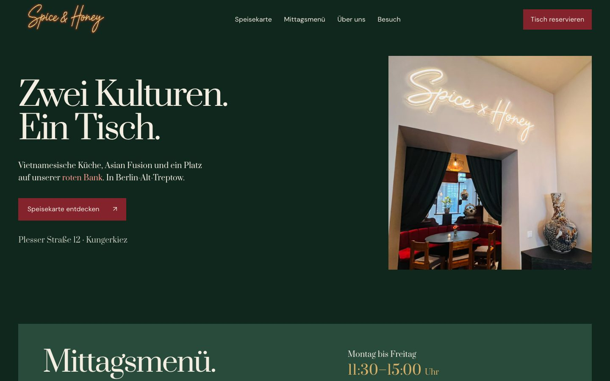

# Spice & Honey Website

Responsive Restaurantwebsite für **Spice & Honey**, Plesser Straße 12, Berlin-Alt-Treptow. Gestaltet aus dem bereitgestellten Concept Board: dunkles Waldgrün für Grundfläche und Kopfzeile, helleres gedecktes Grün für Inhaltsflächen, goldene Markennamen und rubinrote Buttons passend zur Samtbank.



## Enthalten

- Eigenständige Desktop- und Mobilansichten, inklusive mobiler Navigation.
- Dauerhaft sichtbare Kopfzeile mit an ihre Höhe angepassten Sprungzielen.
- Originaler Logo-Schriftzug, 30 aufbereitete Produktfotos auf Anthrazit sowie echte Aufnahmen von privatem Raum, Gastraum und Fassade.
- Getränke und Speisen ohne Foto als kompakte Listen ohne sichtbare Platzhalter. Feste Zuordnung über `photoFrame` in `content/menu.json` und `data-photo-frame` am Menüeintrag erhalten; [Fotoplan](docs/fotoplan.md) und [Rahmenliste](docs/fotorahmen.csv) dienen weiter als Referenz.
- Restaurantkarte mit aktuell 121 sichtbaren Einträgen in 15 Kategorien, einschließlich Kindergerichten, Desserts, Getränken und Varianten. Die sieben Brunchgerichte sind vorläufig ausgeblendet und bleiben in der Datenquelle erhalten.
- Speisen mit Fotokarten, kompakte Getränkelisten und eigene Kategorien; separater Über-uns-Bereich.
- Mittagsmenü-Reiter nach der aktuellen Tafel: Montag bis Freitag, 11:30–15:00 Uhr, wöchentlich wechselnde Gerichte ab 9,50 €. Die aktuelle Auswahl erfahren Gäste beim Team.
- Eigener Instagram-/TikTok-Bereich und kompakter Footer mit kleinem Original-Logo und rechtlichen Links.
- Tischreservierung über den öffentlichen Tebi-Buchungslink; erreichbar im Header und im Besuchsbereich. Allgemeiner Kontakt per E-Mail.
- Öffnungszeiten, geschäftliche E-Mail, anklickbare Telefonnummer und Routenlink.
- Betreibername, Geschäftsanschrift, Kontakt und USt-IdNr. im Impressum; Verantwortliche im Datenschutztext benannt.
- Sichtbarer Tastaturfokus, native Kategorielinks mit markierter Auswahl, Live-Rückmeldung und reduzierte Bewegung.
- Lokale WebP-Bilder und Schriftdatei. Keine Tracker, Cookies oder externen Laufzeitbibliotheken.
- Lokale Prata für Überschriften, Fließtexte und Menüinhalte; lokale DM Sans für Navigation und Bedienelemente. Textgröße 18 px mit großzügigerem Zeilenabstand.

## Lokal starten

Node.js 22 oder neuer. Keine Installation von npm-Paketen erforderlich.

```sh
npm run dev
```

Anschließend `http://127.0.0.1:4173` öffnen. Alternativ lässt sich `index.html` direkt im Browser öffnen.

```sh
npm run check
npm run build
npm run preview
```

Der Build erstellt `dist/` als vollständig statisches Hostingpaket. Der lokale Vorschau-Server ist nur für Entwicklung vorgesehen.

## Inhalte pflegen

Kategorien mit `enabled: false` werden beim Rendern samt Kategorienavigation ausgeblendet. Zum Wiedereinblenden der Brunchkarte diese Eigenschaft in `content/menu.json` entfernen oder auf `true` setzen und den Link im Über-uns-Bereich bei Bedarf wieder ergänzen.

Rahmen 1 zeigt `assets/hero-privater-raum-original.jpg`: die unverändert übernommene Raumaufnahme ohne hinzugefügte Speisen und ohne zusätzliche Bildkompression. Die Bildfläche ist auf 480 CSS-Pixel Breite begrenzt, damit die begrenzte Quellauflösung weniger auffällt. Der Ausschnitt bleibt im Verhältnis 115:121; Pflanze, obere Deckenleuchte und der angeschnittene Stuhl im Vordergrund liegen außerhalb des sichtbaren Bereichs. Für mehr echte Details wird eine höher aufgelöste Aufnahme benötigt. Die verworfene Tischmontage bleibt ausschließlich lokal in `ProductsV2/Startbild/`, wird nicht versioniert und nicht angezeigt.

Die 30 zugeordneten Produktbilder liegen in `assets/menu/` (4:3) und `assets/menu/mobile/` (3:2). Pro Gericht werden `image`, `imageMobile` und `imageAlt` gepflegt. Die mobile Quelle wird bis 600px verwendet; mittige Darstellung mit `object-fit: contain` erhält das vollständige Geschirr. Die Ausgangsdateien, Zuordnungsliste und Vorschauen liegen in [ProductsV2](ProductsV2/Anleitung.md). Die cremige rote Suppe ist mangels bestätigtem Menüeintrag noch nicht eingesetzt.

| Datei | Zweck |
| --- | --- |
| `index.html` | Texte, Öffnungszeiten, generierte Speisekarte, Links und Bildbeschreibungen |
| `content/menu.json` | Pflegbare Quelle für alle Restaurantgerichte, Getränke, Größen und Preise |
| `scripts/render-menu.mjs` | Erstellt die statische, ohne JavaScript lesbare Menüausgabe |
| `app.js` | Mobile Navigation, Kategorienfilter und Direktlinks zur Karte |
| `styles.css` | Markenfarben, responsive Layouts, Typografie und Bewegung |
| `impressum.html` | Gelieferte Betreiber- und Kontaktdaten sowie USt-IdNr. |
| `datenschutz.html` | Entwurf passend zu den implementierten Funktionen |
| `assets/` | Lokal ausgelieferte Bilder, Schrift und Lizenz |
| `docs/design-review.md` | Art Direction, Skill-Anwendung und visuelle Bewertung |
| `docs/qa.md` | Prüfung und bekannte Grenzen |
| `docs/sources.md` | Quellen, Bildherkunft und Nutzungsstand |
| `docs/hosting.md` | Technische Übergabe für einen späteren Websitebetrieb |

Die Restaurantkarte wird in `content/menu.json` gepflegt. Nach einer Änderung `npm run menu:render` für die lokale Vorschau oder `npm run build` für das Hostingpaket ausführen. Der Build rendert die Karte automatisch. Die Website zeigt Vor-Ort-Preise; zu Wolt führt ein externer Bestelllink. Kein automatischer Preisabgleich mit Wolt. Gerichte mit Varianten zeigen die einzelnen Variantenpreise; es gibt keine „ab“-Preiszeile. Kurzbeschreibungen sind keine vollständige Allergenliste. Die wechselnden Lunchbeispiele und die Social-Profillinks werden direkt in `index.html` gepflegt. Die Lunchbeispiele zeigen keine festen Tagespreise oder unbestätigten Angebotszeiten. Für ein finales Gerichtsfoto in einem Eintrag optional `"image": "assets/dateiname.webp"` ergänzen und die Karte neu rendern. Die Karte nutzt feste Bildverhältnisse und bleibt ohne JavaScript vollständig lesbar.

## Vor dem öffentlichen Websitebetrieb

Die noch nicht zugeordneten Antworten zu Punkt 6 und 7 der Betreiberangaben klären; gegebenenfalls Rechtsform, Register- und Erlaubnisangaben ergänzen. Name, Anschrift, Telefonnummer, E-Mail und USt-IdNr. sind eingetragen. Datenschutzhinweise mit der tatsächlichen Verarbeitung beim Mailanbieter und Hosting vervollständigen. Nutzungsrechte für die final ausgewählten Bilder dokumentieren. Die vorhandenen Raum- und Außenaufnahmen werden angezeigt; weitere Shootingfotos bleiben als Auswahlmaterial erhalten. Das originale Logo ist weiterhin eingebunden.

Die Website ist im öffentlichen GitHub-Repository gespeichert. Ein eigenständiger öffentlicher Hostingdienst und eine Domain sind noch nicht eingerichtet.

## Gestaltung

Angewendet: Apple Design, design-taste-frontend und [UI UX Pro Max](https://github.com/nextlevelbuilder/ui-ux-pro-max-skill). Richtung „The dark room“, Seed 1394981396. Die zwei inhaltlich begründeten Blueprintwechsel sind im Designbericht dokumentiert.

Der Code ist für das Restaurant erstellt. Restaurantmedien unterliegen den Rechten ihrer jeweiligen Inhaber. Prata und DM Sans stehen unter SIL Open Font License 1.1; die Lizenzen liegen in `assets/PRATA-LICENSE.txt` und `assets/FONT-LICENSE.txt`.
